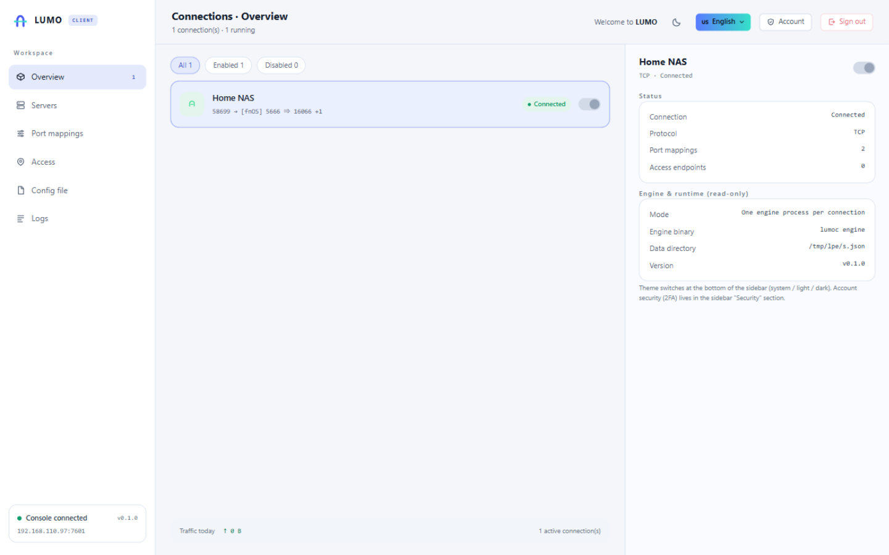

# LUMO 隧光 · 飞牛应用包

[English](README.md) | **简体中文**

**LUMO（隧光）** 的 [飞牛 fnOS](https://www.fnnas.com/) NAS 客户端。装好之后，直接开桌面的
**LUMO** 就能用。

> 一条隧道，两端点亮。把 NAS、路由器、远程桌面和工作机拉进同一个网段 —— 在外面用，和在局域网里
> 用没区别。

<p align="center"> </p>

## 这是什么

一个**纯客户端**应用包：把本机服务通过 LUMO 隧道送出去。服务端单独跑在有公网 IP 的主机上。

- **不占公网端口** —— 密钥隧道与打洞直连都需要密钥，公网侧什么都不暴露
- **四种接入方式** —— 端口映射（TCP / UDP）、按域名反向代理 HTTP / HTTPS、密钥隧道、打洞直连
- **自有协议** —— 长度分帧 JSON 加 Ed25519 签名；服务端只保存公钥
- **装完即用** —— 连接配置由安装向导生成，不用再进控制台配一遍
- **永久在线** —— 开机自启；进程挂掉由守护循环拉起

## 安装

1. 从 [Releases](../../releases) 下载 `lumo-<版本>-x86.fpk`
2. 飞牛应用中心 → 手动安装 → 从 NAS 选择（或直接上传文件）
3. 填写向导：
   - 服务端地址、服务端端口、KCP 端口（填 `0` 表示只走 TCP）
   - 隧道密钥（由服务端提供）
   - 控制台账号与密码
4. 打开桌面的 **LUMO**，用刚才的账号登录

控制台同时监听 unix socket（飞牛桌面网关走这里）和 TCP `7505`（局域网直连）。

## 构建

需要 Go 1.26+ 和 `fnpack`（飞牛自带，或见
[飞牛开发者文档](https://developer.fnnas.com/)）。

```bash
# 编译 linux/amd64 客户端并打包
LUMOC_BIN=/path/to/lumoc-linux ./build.sh
# 产物：lumo.fpk
```

`LUMOC_BIN` 可省略（脚本会自己调 `go build`），也可以指向任意已编译好的 linux/amd64 `lumoc`。

## 目录结构

```text
├── manifest             # 应用元数据（名称、版本、描述、桌面入口）
├── cmd/                 # 生命周期脚本
│   ├── main             #   启停 / 状态 / 守护循环
│   ├── install_init     #   安装前（停掉旧的实例）
│   ├── install_callback #   安装后（控制台凭据、按向导生成连接）
│   ├── config_init      #   设置页读取
│   ├── config_callback  #   设置页保存
│   ├── uninstall_*      #   卸载前后（清进程、可选清数据）
│   └── upgrade_*        #   升级前后
├── config/              # 权限声明与共享数据
├── wizard/              # 安装 / 卸载表单
├── app/
│   ├── bin/lumoc        # 构建产物，不入库
│   └── ui/              # 桌面入口（gatewaySocket）与图标
├── ICON.PNG / ICON_256.PNG
└── build.sh
```

## 运行时布局

| 项目 | 位置 |
|---|---|
| 连接配置 | `<应用数据>/lumo-configs.json` |
| 控制台凭据 | `<应用数据>/console.env` |
| 日志 | `<应用数据>/info.log`、`lumoc.log`、`watchdog.log` |
| 桌面入口 socket | `<安装目录>/app.sock` |

两层进程：`lumoc ui` 负责控制台与连接管理，每条连接再起一个 `lumoc engine` 子进程。主进程用
`setsid` 自成进程组，停止时按组杀，卸载时再按路径清一遍兜底，不留孤儿。

## 坑

飞牛**不会**把 `password` 类型的向导字段作为环境变量传给安装脚本，所以脚本要读的字段必须声明成
`text`。

## 许可

**PolyForm Noncommercial License 1.0.0** —— 可自由使用、修改与分发，**商用需作者授权**。
允许范围与商用授权申请见 [LICENSING.md](LICENSING.md)，完整条款见 [LICENSE](LICENSE)。
