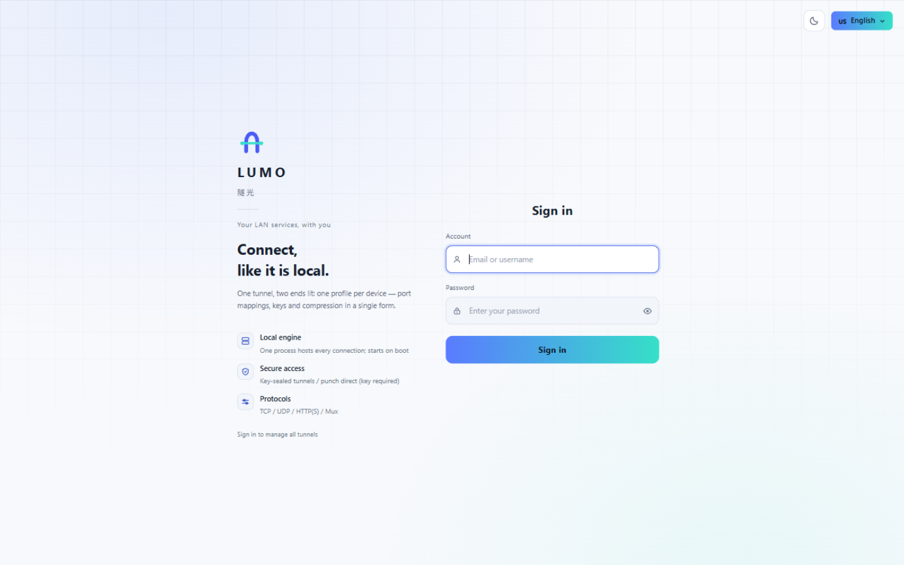
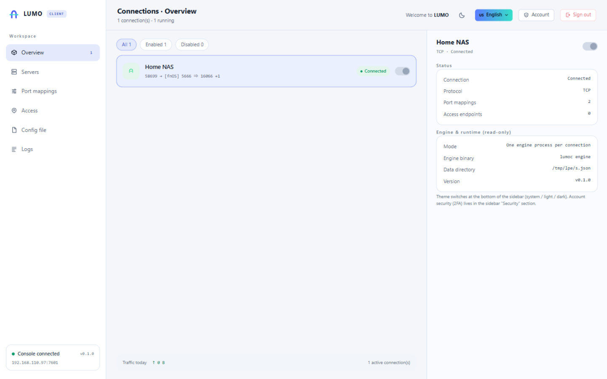

# LUMO · fnOS client package

**English** | [简体中文](README.zh-CN.md)

**LUMO** tunnel client for [fnOS](https://www.fnnas.com/) (the NAS system). Install it and open **LUMO** from the desktop.

> One tunnel, both ends lit. Bring your NAS, router, remote desktops and work machines onto the same
> network — from outside it feels exactly like being on the LAN.

<p align="center"> </p>

## What this is

A **client** application package (the server lives in [server/](../server)): it carries local services out through a LUMO tunnel. The server runs
separately on a host with a public IP.

- **No public ports** — sealed tunnels and punch-through both require a secret key, so nothing is exposed
- **Four ways in** — port mapping (TCP / UDP), HTTP / HTTPS reverse proxy by domain, sealed tunnels, punch-through
- **Own protocol** — length-framed JSON with Ed25519 signatures; the server stores only the public key
- **Works right after install** — the connection is created from the installer wizard, no second setup
- **Always online** — starts on boot, crashed processes are restarted by a watchdog

## Install

1. Download `lumo-<version>-x86.fpk` from [Releases](../../releases)
2. fnOS App Center → Manual install → add from NAS (or upload the file)
3. Fill in the wizard:
   - server address, server port, KCP port (`0` = TCP only)
   - tunnel secret (provided by the server)
   - console account and password
4. Open **LUMO** from the desktop and sign in with that account

The console listens on a unix socket (used by the fnOS desktop gateway) and on TCP `7505` (LAN access).

## Build

Requires Go 1.26+ and `fnpack` (built into fnOS, or see the
[fnOS developer docs](https://developer.fnnas.com/)).

```bash
# compile a linux/amd64 client and pack it
LUMOC_BIN=/path/to/lumoc-linux ./build.sh
# output: lumo.fpk
```

`LUMOC_BIN` is optional (the script will call `go build`); it can point at any prebuilt linux/amd64 `lumoc`.

## Layout

```text
├── manifest             # app metadata (name, version, description, desktop entry)
├── cmd/                 # lifecycle scripts
│   ├── main             #   start / stop / status / watchdog
│   ├── install_init     #   before install (stop the old instance)
│   ├── install_callback #   after install (console credentials, connection from wizard)
│   ├── config_init      #   settings page read
│   ├── config_callback  #   settings page save
│   ├── uninstall_*      #   before/after uninstall (reap processes, optional data wipe)
│   └── upgrade_*        #   before/after upgrade
├── config/              # privilege declaration and shared data
├── wizard/              # install / uninstall forms
├── app/
│   ├── bin/lumoc        # build output, not tracked
│   └── ui/              # desktop entry (gatewaySocket) and icons
├── ICON.PNG / ICON_256.PNG
└── build.sh
```

## Runtime layout

| Item | Location |
|---|---|
| Connection config | `<app data>/lumo-configs.json` |
| Console credentials | `<app data>/console.env` |
| Logs | `<app data>/info.log`, `lumoc.log`, `watchdog.log` |
| Desktop entry socket | `<install dir>/app.sock` |

Two process layers: `lumoc ui` owns the console and connection management, and each connection gets a
`lumoc engine` child. The main process calls `setsid` so it leads its own process group; stopping the group
takes the children with it, and uninstall sweeps by path as a safety net so no orphan is left behind.

## Gotcha

fnOS does **not** pass `password` wizard fields to install scripts as environment variables, so any field a
script reads must be declared as `text`.

## License

**PolyForm Noncommercial License 1.0.0** — free to use, modify and share, **commercial use requires the
author's permission**. See [LICENSING.md](LICENSING.md) for what is allowed and how to obtain a commercial
license; the full text is in [LICENSE](LICENSE).
