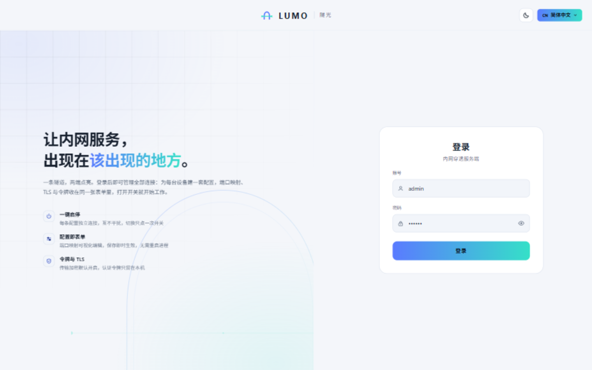
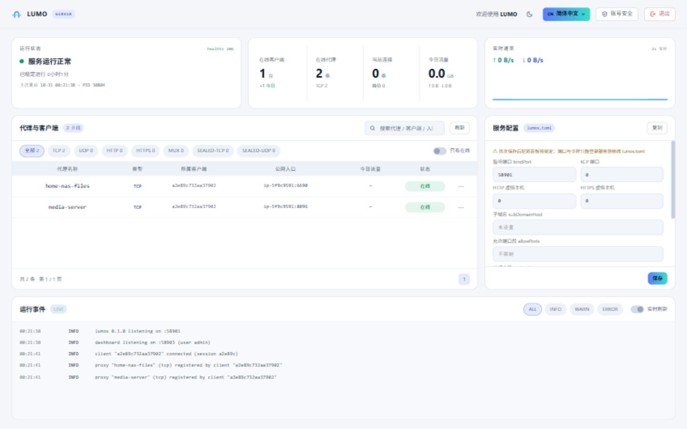

# LUMO · fnOS server package

**English** | [简体中文](README.zh-CN.md)

The **LUMO** tunnel **server** for [fnOS](https://www.fnnas.com/). Install it on the machine with a
public IP, open **LUMO 服务端** from the desktop, and hand the tunnel secret to your clients.

> One tunnel, both ends lit. This end catches tunnels from every client and publishes their services
> to the internet; the [client package](https://github.com/j353719624/lumo-fpk) runs on the NAS or
> desktop behind NAT.

<p align="center"> </p>

## What this is

A **server-only** application package: it runs `lumos`, the end that owns the public ports.

- **No public entry without a key** — sealed tunnels and punch-through are invisible from the
  internet; the server disk stores only the derived public key, never the secret itself
- **Full console** — client/proxy tables with traffic, live events, config panel, tunnel-key
  rotation, TOTP two-factor login
- **Hot changes** — tunnel and KCP ports switch live from the panel; any connection-affecting change
  drops client sessions and they reconnect with the new config by themselves
- **Works right after install** — ports and console credentials come from the installer wizard, the
  tunnel secret is generated automatically
- **Always online** — starts on boot, a watchdog restarts a crashed process within ~10 s

## Install

1. Download `lumo-server-<version>-x86.fpk` from [Releases](../../releases)
2. fnOS App Center → Manual install → upload the file
3. Fill in the wizard:
   - service port (clients connect here, default `58619`)
   - KCP port (`0` disables UDP transport, default `47011`)
   - HTTP virtual-host port (`0` disables, default `18080`)
   - console account and password (empty password = generated, shown in the install log)
4. Open **LUMO 服务端** from the desktop and sign in
5. Read the tunnel secret from the app data folder: `tunnel-secret.txt` — clients need it to
   connect. Rotate it any time from the console (生成新令牌)

The console listens on a unix socket (used by the fnOS desktop gateway), on TCP `46351` (LAN access),
and the tunnel ports from the wizard. Open the wizard ports in your router / firewall so clients can
reach them — `lumos` also opens them in the system firewall automatically where possible.

## Build

Requires Go 1.26+ and `fnpack` (built into fnOS, or see the
[fnOS developer docs](https://developer.fnnas.com/)).

```bash
# compile linux/amd64 binaries and pack
LUMOS_BIN=/path/to/lumos-linux LUMOC_BIN=/path/to/lumoc-linux ./build.sh
# output: lumo-server.fpk
```

Both binaries are optional (the script calls `go build` without them). `lumoc` ships inside the
package because the installer uses its `server` subcommand to generate a matching config file.

## Layout

```text
├── manifest             # app metadata (name, version, description, desktop entry)
├── cmd/                 # lifecycle scripts
│   ├── main             #   start / stop / status / watchdog
│   ├── install_callback #   server config from wizard, auto-generated tunnel secret
│   ├── config_init      #   settings page read
│   ├── config_callback  #   settings page save (console credentials)
│   ├── uninstall_*      #   before/after uninstall (reap processes, optional data wipe)
│   └── upgrade_*        #   before/after upgrade
├── config/              # privilege declaration and shared data
├── wizard/              # install / uninstall forms
├── app/
│   ├── bin/lumos        # build output, not tracked
│   ├── bin/lumoc        # build output, not tracked (config generator for install)
│   └── ui/              # desktop entry (gatewaySocket) and icons
├── ICON.PNG / ICON_256.PNG
└── build.sh
```

## Runtime layout

| Item | Location |
|---|---|
| Server config | `<app data>/lumos.toml` |
| Tunnel secret | `<app data>/tunnel-secret.txt` (0600) |
| Logs | `<app data>/info.log`, `lumos.log`, `watchdog.log` |
| Desktop entry socket | `<install dir>/app.sock` |

`lumos` runs under `setsid` as its own process group; stop kills the group and uninstall sweeps by
path as a safety net, so no orphan is left behind. The lifecycle scripts run from
`/var/apps/lumo-server/cmd/` — never edit `lumos.toml` while the service is running; the console
config panel is the supported way to change ports.

## Gotcha

fnOS does **not** pass `password` wizard fields to install scripts as environment variables, so any
field a script reads must be declared as `text`.

## License

**PolyForm Noncommercial License 1.0.0** — free to use, modify and share, **commercial use requires the
author's permission**. See [LICENSING.md](../LICENSING.md) for what is allowed and how to obtain a commercial
license; the full text is in [LICENSE](../LICENSE).
