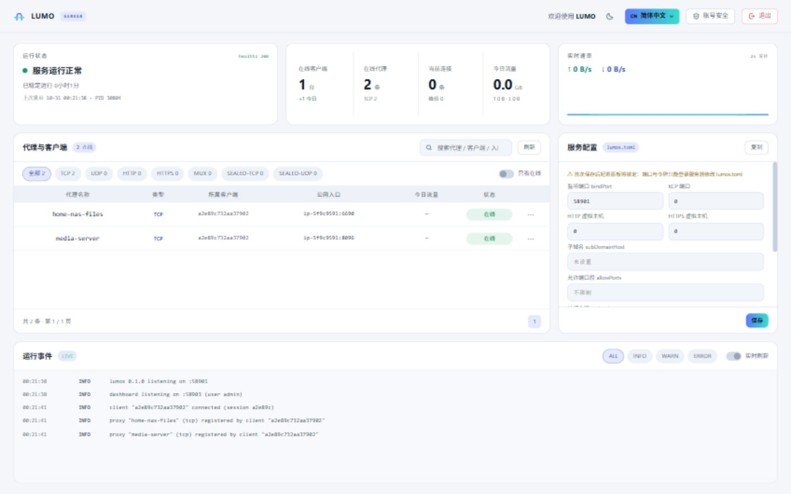

# LUMO 隧光 · 飞牛服务端应用包

[English](README.md) | **简体中文**

**LUMO（隧光）** 的 [飞牛 fnOS](https://www.fnnas.com/) **服务端**。装在有公网 IP 的那台机器上，
从桌面打开「LUMO 服务端」，把隧道密钥发给客户端就能用了。

> 一条隧道，两端点亮。这一端接住各地客户端的隧道，把它们的内网服务发布到公网；NAT 后面的
> NAS / 电脑装[客户端应用包](https://github.com/j353719624/lumo-fpk)。

<p align="center"> </p>

## 这是什么

一个**纯服务端**应用包：跑的是 `lumos`，占公网端口、接隧道的那一端。

- **无密钥不可达** —— 密钥隧道与打洞直连在公网上看不到任何入口；服务端磁盘只保存派生公钥，
  密钥本身不落盘
- **完整控制台** —— 客户端与代理列表带流量统计、实时事件、配置面板、隧道密钥轮换、TOTP 两步登录
- **改动即生效** —— 隧道端口与 KCP 端口可在面板热切换；任何影响连接的变更立即断开客户端会话，
  客户端自动用新配置重连
- **装完即用** —— 端口与控制台账号由安装向导生成，隧道密钥自动生成
- **永久在线** —— 开机自启；进程挂掉约 10 秒内被守护循环拉起

## 安装

1. 从 [Releases](../../releases) 下载 `lumo-server-<版本>-x86.fpk`
2. 飞牛应用中心 → 手动安装 → 上传文件
3. 填写向导：
   - 服务端口（客户端连接用，默认 `58619`）
   - KCP 端口（填 `0` 关闭 UDP 传输，默认 `47011`）
   - HTTP 虚拟主机端口（填 `0` 关闭，默认 `18080`）
   - 控制台账号与密码（密码留空自动生成，装完在应用日志里看）
4. 打开桌面的「LUMO 服务端」登录
5. 到应用数据目录读 `tunnel-secret.txt` —— 客户端连接要用它。之后随时可在控制台轮换
   （生成新令牌）

控制台同时监听 unix socket（飞牛桌面网关走这里）、TCP `46351`（局域网直连）和向导里填的隧道
端口。路由器 / 防火墙记得放行这几个端口 —— `lumos` 会尽力自动放行系统防火墙。

## 构建

需要 Go 1.26+ 和 `fnpack`（飞牛自带，或见
[飞牛开发者文档](https://developer.fnnas.com/)）。

```bash
# 编译 linux/amd64 二进制并打包
LUMOS_BIN=/path/to/lumos-linux LUMOC_BIN=/path/to/lumoc-linux ./build.sh
# 产物：lumo-server.fpk
```

两个二进制都可以省略（脚本会自己调 `go build`）。包里带 `lumoc` 是因为安装脚本用它的
`server` 子命令生成配套的服务端配置。

## 目录结构

```text
├── manifest             # 应用元数据（名称、版本、描述、桌面入口）
├── cmd/                 # 生命周期脚本
│   ├── main             #   启停 / 状态 / 守护循环
│   ├── install_callback #   按向导生成服务端配置，自动生成隧道密钥
│   ├── config_init      #   设置页读取
│   ├── config_callback  #   设置页保存（控制台凭据）
│   ├── uninstall_*      #   卸载前后（清进程、可选清数据）
│   └── upgrade_*        #   升级前后
├── config/              # 权限声明与共享数据
├── wizard/              # 安装 / 卸载表单
├── app/
│   ├── bin/lumos        # 构建产物，不入库
│   ├── bin/lumoc        # 构建产物，不入库（安装时生成配置用）
│   └── ui/              # 桌面入口（gatewaySocket）与图标
├── ICON.PNG / ICON_256.PNG
└── build.sh
```

## 运行时布局

| 项目 | 位置 |
|---|---|
| 服务端配置 | `<应用数据>/lumos.toml` |
| 隧道密钥 | `<应用数据>/tunnel-secret.txt`（0600） |
| 日志 | `<应用数据>/info.log`、`lumos.log`、`watchdog.log` |
| 桌面入口 socket | `<安装目录>/app.sock` |

`lumos` 用 `setsid` 自成进程组，停止按组杀，卸载再按路径清一遍兜底，不留孤儿。生命周期脚本
实际运行于 `/var/apps/lumo-server/cmd/` —— 服务运行时不要手改 `lumos.toml`，改端口走控制台
配置面板。

## 坑

飞牛**不会**把 `password` 类型的向导字段作为环境变量传给安装脚本，所以脚本要读的字段必须声明成
`text`。

## 许可

**PolyForm Noncommercial License 1.0.0** —— 可自由使用、修改与分发，**商用需作者授权**。
允许范围与商用授权申请见 [LICENSING.md](../LICENSING.md)，完整条款见 [LICENSE](../LICENSE)。
